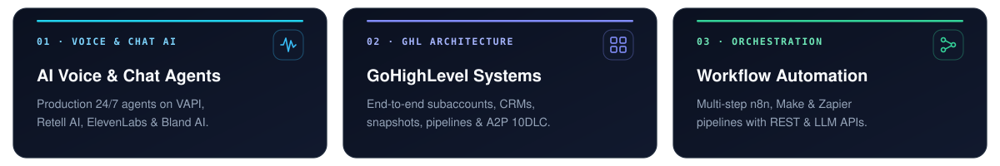

<div align="center">

<picture>
  <source media="(prefers-color-scheme: light)" srcset="./assets/hero-light.svg" />
  
</picture>

<p>
  <a href="https://github.com/meyadstack"><strong>GitHub Profile</strong></a>
  &nbsp;·&nbsp;
  <a href="https://github.com/meyadstack?tab=repositories"><strong>Repositories</strong></a>
  &nbsp;·&nbsp;
  <a href="https://github.com/meyadstack?tab=stars"><strong>Starred</strong></a>
</p>

</div>

<picture>
  <source media="(prefers-color-scheme: light)" srcset="./assets/divider-light.svg" />
  
</picture>

<h2>About &amp; Focus</h2>

<table width="100%">
<tr>
<td width="56%" valign="top">
<p>
Hi, I'm <strong>Abdullah Al Meyad</strong> (<code>@meyadstack</code>) — a product-minded developer focused on turning ideas into clean, reliable, and thoughtfully crafted software.
</p>
<p><strong>Currently exploring &amp; building:</strong></p>
<ul>
<li>Clean user interfaces and responsive web experiences</li>
<li>Maintainable APIs, tooling, and developer workflows</li>
<li>Practical open-source projects shared in public</li>
</ul>
</td>
<td width="44%" valign="top">

```ts
const meyadstack = {
  name: "Abdullah Al Meyad",
  handle: "@meyadstack",
  focus: "shipping useful software",
  values: [
    "clarity over noise",
    "craft in the details",
    "build in public",
  ],
} as const;
```

</td>
</tr>
</table>

<picture>
  <source media="(prefers-color-scheme: light)" srcset="./assets/divider-light.svg" />
  
</picture>

<h2>How I Build</h2>

<picture>
  <source media="(prefers-color-scheme: light)" srcset="./assets/principles-light.svg" />
  
</picture>

<picture>
  <source media="(prefers-color-scheme: light)" srcset="./assets/divider-light.svg" />
  
</picture>

<h2>Featured Work</h2>

> **Fresh workspace in motion** — new public repositories and open-source experiments will land here as they ship.
> Explore upcoming releases on the <a href="https://github.com/meyadstack?tab=repositories">Repositories tab</a>.

<!--
Uncomment and customize this 2-column showcase when your first repositories are live:

<table width="100%">
  <tr>
    <td width="50%" valign="top">
      <p><a href="https://github.com/meyadstack/project-one"><strong>project-one</strong></a></p>
      <p>Short description of what it solves and the stack behind it.</p>
    </td>
    <td width="50%" valign="top">
      <p><a href="https://github.com/meyadstack/project-two"><strong>project-two</strong></a></p>
      <p>Short description of what it solves and the stack behind it.</p>
    </td>
  </tr>
</table>
-->

<picture>
  <source media="(prefers-color-scheme: light)" srcset="./assets/divider-light.svg" />
  
</picture>

<div align="center">

<picture>
  <source media="(prefers-color-scheme: light)" srcset="./assets/footer-light.svg" />
  
</picture>

<p><sub>Built with pure SVG &amp; GitHub-Flavored Markdown · <a href="https://github.com/meyadstack">@meyadstack</a></sub></p>

</div>
